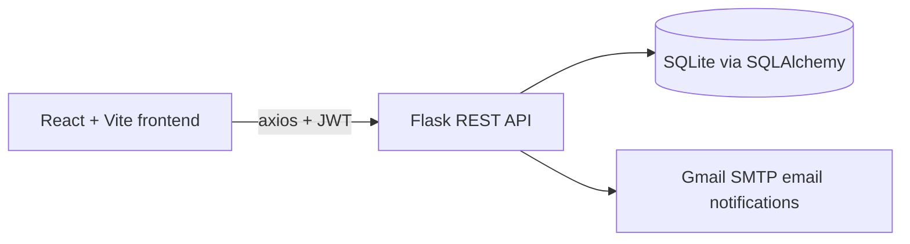

# 🏥 Secure and Scalable Healthcare System

A full-stack web application where **patients, doctors, and admins** manage appointments and electronic health records (EHR) in one secure place. Every action is protected by JWT login and role-based access, and every appointment is checked against the doctor's real working hours.

> 📌 Backend API details: [Backend.md](./Backend.md)

## 💡 Why I built this

Health records and appointments are often scattered across paper files and phone calls. I wanted to build one system where a patient can book a visit, a doctor can update records, and an admin can manage everyone, while making sure each person sees only what their role allows.

---

## ✨ Features

### 👤 Patient
- Register and log in securely
- Book appointments with a doctor, only inside the doctor's available days and times
- View and cancel scheduled appointments
- View personal health record and medication history
- Receive an email confirmation after booking

### 🩺 Doctor
- View upcoming appointments and update their status
- Create, view, edit, and delete patient EHR records
- Prescribe and track medications linked to a health record
- Search patients

### 🛠️ Admin
- Dashboard with totals for doctors, patients, appointments, EHR records, and medications
- Add, search, edit, and delete doctors and patients
- View and delete any EHR record

### 🔐 Security
- Passwords are hashed (PBKDF2-SHA256), never stored as plain text
- JWT-based authentication, with the user's role stored in the token
- Role checks on the **backend** for every protected API (returns 403 for the wrong role)
- Role-based protected routes on the frontend
- Doctor and admin registration needs a secret key
- Forgot-password flow with a reset link that expires in 1 hour
- Appointments in the past are rejected on both the frontend and the backend

---

## 🧱 Architecture



The backend is split into Flask blueprints (auth, appointments, EHR, medications, admin, users), so each feature can grow without touching the others. JWT login keeps the server stateless, and SQLAlchemy lets the database change (for example, to PostgreSQL) without rewriting the data code.

---

## ⚙️ Tech Stack

| Layer | Technologies |
|-------|--------------|
| Frontend | React 19, Vite, Tailwind CSS, React Router, axios, react-datepicker |
| Backend | Python Flask, Flask-JWT-Extended, Flask-SQLAlchemy, Flask-Migrate, Flask-CORS |
| Database | SQLite (development), SQLAlchemy ORM |
| Email | Gmail SMTP (`smtplib`) |
| Tools | Postman for API testing, Git and GitHub |

---

## 🗂️ Project Structure

```
secure and scalable HealthCare System/
├── backend/
│   ├── app/
│   │   ├── auth/            # login, register, JWT, password reset
│   │   ├── appointments/    # booking and availability logic
│   │   ├── ehr/             # health record logic
│   │   ├── models/          # User, Appointment, EHR, Medication
│   │   ├── notifications/   # email service
│   │   └── routes/          # API blueprints
│   ├── migrations/          # Flask-Migrate database history
│   ├── config.py
│   └── run.py
├── frontend/
│   └── src/
│       ├── components/      # PrivateRoute
│       └── pages/           # Login, Register, patient, doctor, admin dashboards
├── .env.example
└── Backend.md
```

---

## 🗃️ Data Model

| Table | Purpose |
|-------|---------|
| `User` | Name, email, hashed password, role, doctor specialization and availability |
| `Appointment` | Patient, doctor, time (stored in UTC), reason, status |
| `EHR` | Patient health record: age, gender, blood group, conditions |
| `Medication` | Prescribed medicines linked to an EHR and the prescribing doctor |

A doctor's availability is stored as JSON, for example:

```json
{ "monday": { "start": "09:00", "end": "17:00" } }
```

---

## 🔌 API Overview

| Area | Endpoints |
|------|-----------|
| Auth | `POST /api/auth/register`, `/login`, `/forgot-password`, `/reset-password` |
| Appointments | `POST /api/appointments/book`, `GET /patient`, `GET /doctor`, `PUT /<id>/status`, `DELETE /<id>` |
| EHR | `POST /api/ehr/create`, `GET /list`, `PUT /update/<id>`, `DELETE /delete/<id>`, `POST /search`, `GET /patient/<id>` |
| Admin | `GET /api/admin/doctors`, `/patients`, `/ehrs`, `DELETE /doctor/<id>`, `/patient/<id>`, `/ehr/<id>` |
| Users | `GET /api/users/doctors` |

---

## 🚀 Getting Started

### 1. Clone the project
```bash
git clone https://github.com/MalliVerse/healthcare-system.git
cd healthcare-system
```

### 2. Set up the environment file
Copy `.env.example` to `.env` and fill in your own values:

```env
SECRET_KEY=your-long-random-secret
ADMIN_SECRET=secret-needed-to-register-doctors-and-admins
EMAIL_USER=your-gmail-address
EMAIL_PASS=your-gmail-app-password
FRONTEND_URL=http://localhost:5173
```

> Never commit your real `.env` file. It is listed in `.gitignore`.

### 3. Run the backend
```bash
cd backend
python -m venv venv
venv\Scripts\activate        # Windows
pip install -r requirements.txt
flask db upgrade
python run.py
```
The API runs at `http://127.0.0.1:5000`.

### 4. Run the frontend (new terminal)
```bash
cd frontend
npm install
npm run dev
```
Open the link shown in the terminal, usually `http://localhost:5173`.

---

## 🧪 How to try it

1. Register a **patient** account, then log in.
2. Register a **doctor** account using your `ADMIN_SECRET`, and set the doctor's available days and times.
3. As the patient, book an appointment inside the doctor's available time.
4. Check your email for the confirmation.
5. Log in as the doctor to update the appointment and create a health record.

---

## 🖼️ Screenshots

| Login | Patient Dashboard |
|-------|-------------------|
|  |  |

| Doctor Dashboard | Admin Dashboard |
|------------------|-----------------|
|  |  |

---

## 🔭 Future Improvements

- Prevent two patients from booking the same time slot
- Move from SQLite to PostgreSQL for production
- Store the JWT in a more secure way and add token refresh
- SMS reminders for upcoming appointments
- Docker setup and cloud deployment
- Automated tests for the API

---

## 👨‍💻 Author

Built by **Mallikarjuna** · GitHub: [@MalliVerse](https://github.com/MalliVerse)
